<!-- A GitHub-native profile: generated waves, live metrics, and the existing Pac-Man workflow. -->

  

**From the interface to the infrastructure.**

I build web software with TypeScript, design the data and business logic behind it,  
and run the services that keep it online.

Software engineering student · Béjaïa, Algeria

  <a href="https://heithemdev.com"><strong>Portfolio</strong></a>
  &nbsp;·&nbsp;
  <a href="https://www.linkedin.com/in/heithemdev/">LinkedIn</a>
  &nbsp;·&nbsp;
  <a href="https://x.com/Heithemdev">X</a>
  &nbsp;·&nbsp;
  <a href="mailto:heithem.dev@gmail.com">Email</a>

---

### The stack

<table>
  <tr>
    <td width="33%" valign="top">
      01 &nbsp; / &nbsp; APPLICATION
        
      <strong>Next.js · React</strong> 
      <code>TypeScript</code> <code>Tailwind CSS</code>
    </td>
    <td width="33%" valign="top">
      02 &nbsp; / &nbsp; DATA &amp; BACKEND
        
      <strong>Node.js · PostgreSQL</strong> 
      <code>Prisma</code> <code>REST APIs</code>
    </td>
    <td width="34%" valign="top">
      03 &nbsp; / &nbsp; OPERATIONS
        
      <strong>Linux · Nginx</strong> 
      <code>Cloudflare</code> <code>CI/CD</code>
    </td>
  </tr>
</table>

Right now: multi-tenant architecture, query performance, caching, and keeping small production systems dependable.

### Code, in numbers

  
   
  Generated from GitHub repository data. Private client work may not be represented.

### Contributions, with a twist

<picture>
  <source
    media="(prefers-color-scheme: dark)"
    srcset="https://raw.githubusercontent.com/heithemdev/heithemdev/output/pacman-contribution-graph-dark.svg"
  />
  <source
    media="(prefers-color-scheme: light)"
    srcset="https://raw.githubusercontent.com/heithemdev/heithemdev/output/pacman-contribution-graph.svg"
  />
  
</picture>

  For the things I've shipped, see <a href="https://heithemdev.com">heithemdev.com</a>. For the code, you're already in the right place.
  

